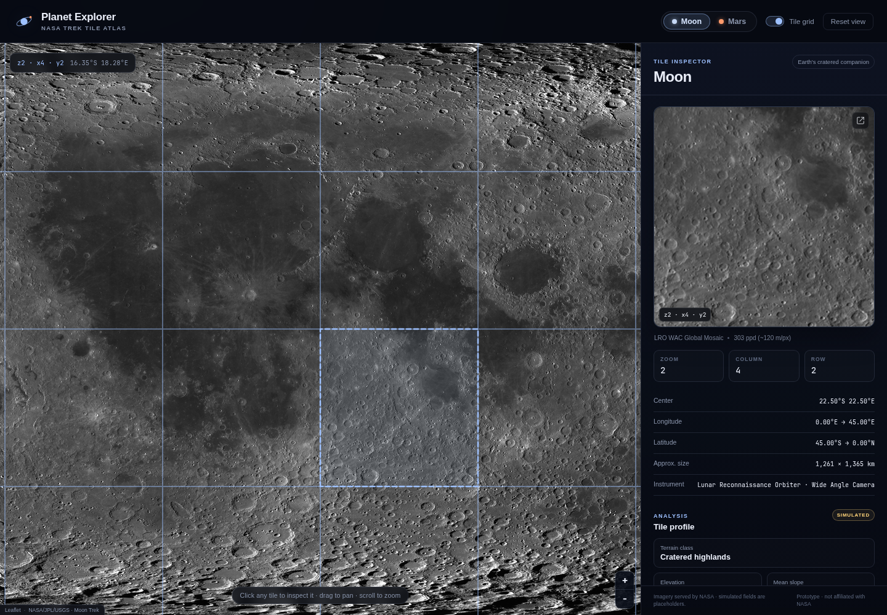
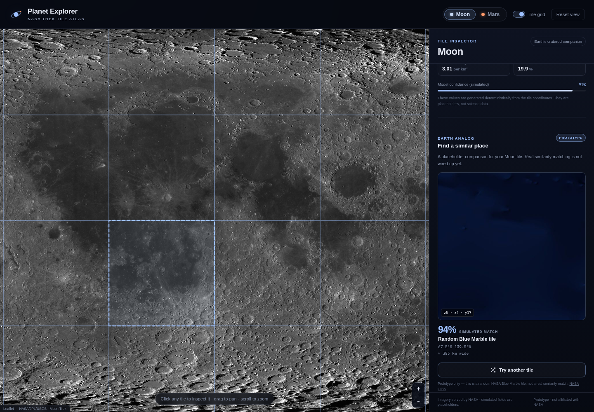

# Planet Explorer

A small full-stack app for exploring NASA imagery of the Moon and Mars. Pick a body, click any map tile to inspect it, and preview a placeholder "similar place on Earth".

The app is intentionally simple: no database, no auth, no API keys, and no tile proxy. Map imagery is loaded directly from NASA.



## Features

- **Moon and Mars basemaps** from NASA Trek, on the same 2:1 equirectangular tile grid.
- **Click-to-select tiles** with a highlighted outline, hover coordinates, and a toggleable tile grid.
- **Tile inspector** showing the tile's NASA layer, zoom/column/row, center, bounds, and approximate ground size.
- **Simulated tile analysis** (terrain, elevation, slope, and other fields) generated deterministically from the tile coordinates. Clearly labeled as placeholder data.
- **Earth analog placeholder**: returns a random NASA Blue Marble tile and a simulated match percentage. Real similarity matching is not implemented yet.
- Zoom limits are enforced per body: Moon z0–8, Mars z0–7.
- Responsive layout for desktop and mobile.

The Earth comparison is a prototype placeholder:



## Stack

| Layer    | Technology |
| -------- | ---------- |
| Frontend | React 19, TypeScript, Vite, Leaflet / react-leaflet, plain CSS |
| Backend  | Python 3.12+, FastAPI, Pydantic |
| Tooling  | `uv` (Python), `pnpm` (Node), pytest, Vitest |

## Quick start

### 1. Backend

```bash
cd backend
uv sync
uv run uvicorn app.main:app --reload --port 8000
```

The API is available at <http://127.0.0.1:8000>, with interactive docs at <http://127.0.0.1:8000/docs>.

### 2. Frontend (development)

In a second terminal:

```bash
cd frontend
pnpm install
pnpm dev
```

Open <http://localhost:5173>. Vite proxies `/api` requests to the backend on port 8000.

### 3. Production-style build

Build the frontend, then start the backend. FastAPI will serve the generated `frontend/dist` directory at the root URL.

```bash
cd frontend
pnpm build

cd ../backend
uv run uvicorn app.main:app --port 8000
```

Open <http://127.0.0.1:8000>.

## API

| Method | Endpoint | Description |
| ------ | -------- | ----------- |
| GET | `/api/health` | Health check |
| GET | `/api/bodies` | Moon and Mars layer configuration |
| GET | `/api/tiles/{body}/{z}/{x}/{y}` | Tile metadata, bounds, and simulated analysis |
| GET | `/api/earth/random?seed=...` | Random Earth placeholder tile (seed optional and reproducible) |

Examples:

```bash
curl http://127.0.0.1:8000/api/tiles/moon/4/3/2
curl http://127.0.0.1:8000/api/tiles/mars/5/10/12
curl "http://127.0.0.1:8000/api/earth/random?seed=42"
```

Unknown bodies return `404`; invalid zoom levels or tile indexes return `422`.

## Tests

```bash
# From the project root

# Backend
(cd backend && uv run pytest)

# Frontend unit tests
(cd frontend && pnpm test)

# Type-check + production build
(cd frontend && pnpm build)

# Lint
(cd frontend && pnpm lint)
```

## Data sources

- **Moon imagery**: [LRO WAC Global Mosaic](https://trek.nasa.gov/moon/) (`LRO_WAC_Mosaic_Global_303ppd_v02`) from NASA Trek.
- **Mars imagery**: [Viking Global Color Mosaic](https://trek.nasa.gov/mars/) (`Mars_Viking_MDIM21_ClrMosaic_global_232m`) from NASA Trek.
- **Earth placeholder**: [NASA GIBS Blue Marble Shaded Relief + Bathymetry](https://gibs.earthdata.nasa.gov/), 500m.

Imagery is © NASA/JPL/USGS and is loaded directly in the browser from NASA servers. Attribution is displayed on the map.

## Tile grid notes

NASA Trek uses a 2:1 equirectangular grid, matching Leaflet's `L.CRS.EPSG4326`:

- `cols = 2^(z + 1)`, `rows = 2^z`
- Tile URL order is `{z}/{y}/{x}` (row before column)
- `west = -180 + (x / cols) * 360`, `north = 90 - (y / rows) * 180`

Trek does not expose a per-tile metadata endpoint, so bounds, center, and approximate size are computed by the backend from the tile index.

## What is simulated

The app is a prototype:

- The **analysis fields** in the Moon/Mars tile panel (terrain class, elevation, slope, etc.) and the confidence value are placeholders generated from a hash of `body/z/x/y`. They are stable for a given tile but are **not** science data.
- The **Earth result** is a **random** Blue Marble tile. The match percentage and "similar place" framing are simulated. A real version would use terrain embeddings or another similarity service.

## Project layout

```text
planet-explorer/
├── backend/
│   ├── app/
│   │   ├── main.py          # FastAPI app and routes
│   │   ├── config.py        # Moon/Mars layer configuration
│   │   ├── tiles.py         # tile math and response building
│   │   ├── simulated.py     # deterministic placeholder analysis
│   │   ├── earth.py         # random Earth placeholder
│   │   └── models.py        # Pydantic response models
│   └── tests/
└── frontend/
    ├── src/
    │   ├── App.tsx
    │   ├── components/
    │   ├── lib/tileMath.ts
    │   └── api/client.ts
    └── vite.config.ts       # /api dev proxy
```

## Possible next steps

- Real Earth similarity search using terrain or spectral embeddings.
- Add more NASA layers (e.g., Mars MOLA/HRSC shaded relief, lunar mineralogy).
- Server-side tile caching and an offline-friendly fallback.
- Shareable URLs for selected body/tile/Earth result.
- A small database or cache for precomputed tile analyses.

Not affiliated with NASA.
