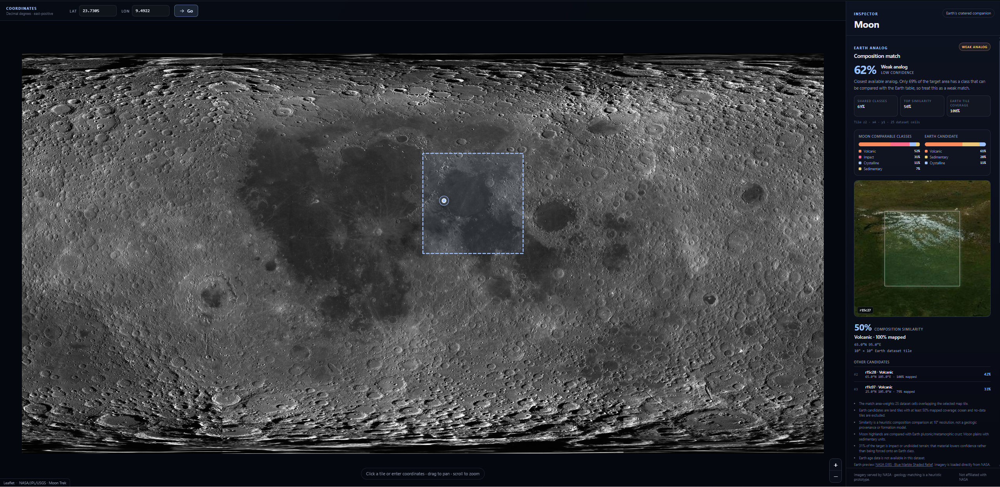
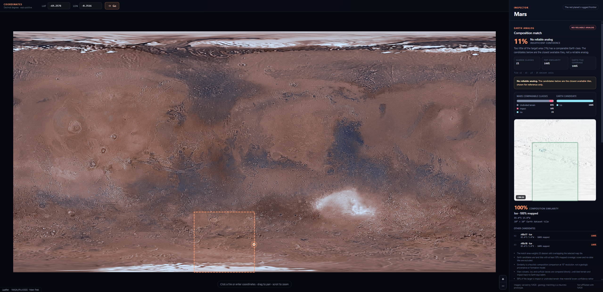

# Nazeer

**Find the Earth place that looks most like a spot on the Moon or Mars.**

Nazeer (نظير, "counterpart") is a web app built for the **NASA Space Apps Challenge 2026** by team **0xcs**, for the challenge [Permanent Moon Base Locations and Mars](https://www.spaceappschallenge.org/2026/challenges/permanent-moon-base-locations-and-mars/).

Team page: <https://www.spaceappschallenge.org/2026/find-a-team/0xcs/?tab=details>

Pick the Moon or Mars, click a map tile or type a coordinate, and Nazeer shows the geology of that spot and the closest matching places on Earth. Each Earth match comes with a confidence score and a NASA satellite preview. When no reliable Earth match exists, the app says so.

**Live app:** <https://nazeer-uey5.vercel.app/>

## Screenshots

| Moon | Mars |
|---|---|
|  |  |

## Features

- Moon and Mars basemaps from NASA Trek (Moon zoom 0-8, Mars zoom 0-7).
- Two ways to choose a target: click a map tile (area-weighted match), or enter latitude/longitude (matches the 10° cell containing the point).
- Real geology for the target: surface classes, mapped fraction and age bins.
- Top 3 Earth analogs with confidence (high / medium / low / **No reliable analog**), similarity, coverage, and the class mix of each.
- NASA GIBS satellite preview of every Earth candidate, with the matched cell outlined.
- Matching needs zoom 2 or deeper. Layout works on desktop and mobile.

## Stack

| Layer | Technology |
|---|---|
| Frontend | React 19, TypeScript, Vite, Leaflet / react-leaflet, plain CSS |
| Backend | Python 3.12+, FastAPI, Pydantic |
| Tooling | `uv`, `pnpm`, pytest, Vitest, oxlint |
| Hosting | Vercel (frontend proxies `/api` to the deployed backend) |

## Quick start

```bash
# 1. Backend
cd backend
uv sync
uv run uvicorn app.main:app --reload --port 8000     # docs at /docs

# 2. Frontend (second terminal)
cd frontend
pnpm install
pnpm dev                                              # http://localhost:5173
```

Production-style: run `pnpm build` in `frontend/`, then start the backend. FastAPI serves `frontend/dist` at `/`.

### Build the Earth candidate grid

The Earth table (`earth_tiles_5deg.csv`) is generated from the GLiM raster and is not committed (CSV files are git-ignored). Generate it once:

```bash
python backend/scripts/build_earth_grid.py
```

`targets_10deg.csv` (Moon and Mars geology) must be in `backend/data/geology/`.

## How to use

1. Choose **Moon** or **Mars**.
2. Click a tile, or type decimal-degree coordinates (lat -90..90, lon -180..180, east-positive) and press **Go**.
3. Read the Earth match panel (confidence, similarity, coverage, class mix), then the tile panel (raw Moon/Mars classes and age bins).

## API

| Method | Endpoint | Description |
|---|---|---|
| GET | `/api/health` | Health check |
| GET | `/api/bodies` | Moon and Mars layer configuration |
| GET | `/api/tiles/{body}/{z}/{x}/{y}` | Tile bounds, size and aggregated geology |
| GET | `/api/matches/{body}/{z}/{x}/{y}` | Earth match for a map tile (z2+) |
| GET | `/api/matches/{body}/point?lat=..&lon=..` | Earth match for the 10° cell at a coordinate |

Unknown body → `404`. Bad zoom, tile index or coordinate (or zoom below 2 for matching) → `422`.

## How matching works

1. **Common grid.** Moon and Mars geology are summarized on a 10° grid (18 × 36 = 648 cells). Earth is summarized on a finer 5° grid (36 × 72) built from the GLiM 0.5° raster with cosine-latitude area weights.
2. **Harmonized classes.** volcanic → volcanic, ice → ice, Mars surficial → Earth surficial, Moon highlands → Earth plutonic + metamorphic ("crystalline"), Moon plains → Earth sedimentary. Impact and Mars undivided terrain have no Earth equivalent: they are not forced onto a class and instead lower the confidence.
3. **Candidates.** Earth cells need at least 60% mapped land coverage and enough comparable mass. They are ranked by the **Bhattacharyya coefficient** on the class mix, then thinned so alternatives are at least 20° apart.
4. **Featured analog.** Among candidates at least 65% as similar as the best one, the app prefers the same class family, then the one nearest the target. This is a presentation choice, not a geologic claim.
5. **Confidence** combines similarity, shared (comparable) area, candidate coverage and the margin over the next candidate.

## Data

| Data | Source | Link |
|---|---|---|
| Moon imagery | NASA Trek, LRO WAC Global Mosaic | https://trek.nasa.gov/moon/ |
| Mars imagery | NASA Trek, Viking Global Color Mosaic | https://trek.nasa.gov/mars/ |
| Trek documentation | NASA Solar System Treks | https://trek.nasa.gov/ |
| Earth preview | NASA GIBS, Blue Marble Shaded Relief + Bathymetry | https://gibs.earthdata.nasa.gov/ |

### Geology datasets

| Body | Dataset | Link |
|---|---|---|
| Earth | Global Lithological Map (GLiM) v1.0, Hartmann & Moosdorf (2012), CC BY 3.0 | https://www.dropbox.com/scl/fi/5v00i8op7a9brmn4qeg8b/LiMW_GIS-2015.gdb.zip?rlkey=89q1aj8zfpmiv82y41xe6ttmp&e=1&dl=0 |
| Moon | USGS Unified Geologic Map of the Moon, 1:5M, GIS v2 | https://astrogeology.usgs.gov/search/map/Moon/Geology/Unified_Geologic_Map_of_the_Moon_GIS_v2/ |
| Mars | USGS Geologic Map of Mars, SIM 3292 | https://pubs.usgs.gov/publication/sim3292 |

### Elevation datasets

Processed in a separate terrain-shape pipeline that is not part of the final app.

| Body | Dataset | Link |
|---|---|---|
| Earth | GMT `earth_relief_01m_p` (SRTM15+) | https://www.generic-mapping-tools.org/remote-datasets/index.html |
| Moon | USGS LRO LOLA Global DEM 118 m | https://astrogeology.usgs.gov/search/map/moon_lro_lola_dem_118m |
| Mars | USGS MGS MOLA and Mars Express HRSC Blended DEM 200 m | https://astrogeology.usgs.gov/search/map/mars_mgs_mola_mex_hrsc_blended_dem_global_200m |

Full details: [DOCUMENTATION.md](DOCUMENTATION.md). Imagery © NASA/JPL/USGS, with attribution shown on the map.

## Limitations

- Earth coverage is land-only, so ocean matches are impossible by design.
- Class systems differ between bodies; the crosswalk is a heuristic.
- Cells are regional (5° and 10°), far coarser than rover scale.
- Mars is mapped at 1:20M and much of it is "undivided terrain", so many Mars targets correctly return "No reliable analog".
- No Earth age comparison; ages are shown for Moon and Mars only.
- Geological similarity is **not** landing-site or base suitability. Slope, boulders, regolith, radiation, thermal and illumination conditions are not assessed.

## Tests

```bash
(cd backend && uv run pytest)
(cd frontend && pnpm test && pnpm build && pnpm lint)
```

## Project layout

```text
Nazeer/
├── backend/
│   ├── app/            main.py, config.py, tiles.py, geology.py, models.py
│   ├── scripts/        build_earth_grid.py
│   ├── data/geology/   targets_10deg.csv, glim/ (raster + class names)
│   └── tests/
├── frontend/src/       App.tsx, components/, lib/, api/client.ts
└── README.md
```

## Team

Team **0xcs**, NASA Space Apps Challenge 2026.

> **Note:** this is a demo only and the data is not accurate.
